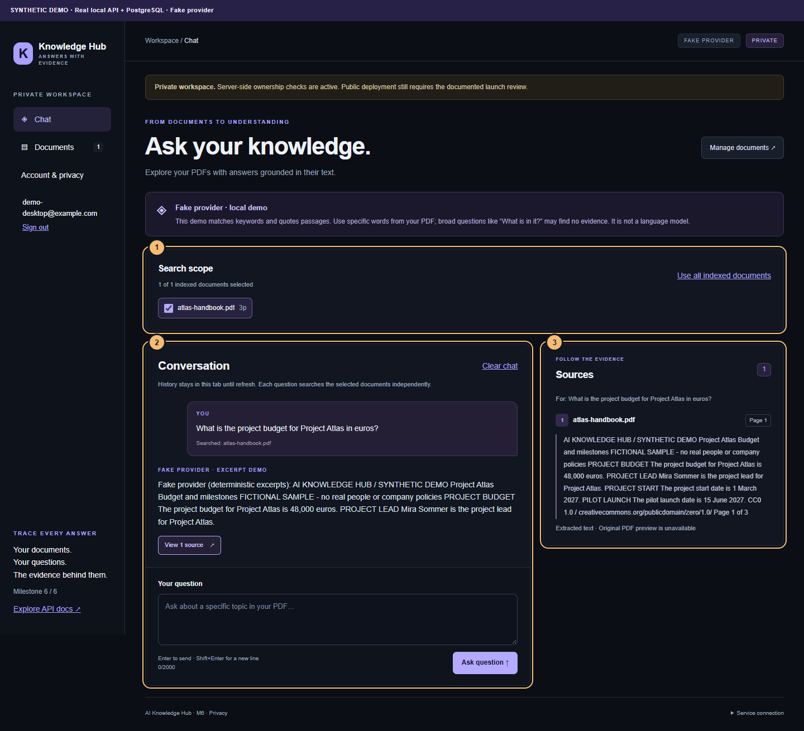

# AI Knowledge Hub

A multi-user document question-answering portfolio project built with **Next.js, TypeScript, Python, FastAPI and PostgreSQL/pgvector**. Upload PDFs, select a private search scope, and inspect answers beside the original filename, page number and extracted passage. **M1–M6 cover the working local application and its portfolio materials.** Public deployment still requires the [launch review](docs/security.md).



*Actual UI/API/PostgreSQL capture with synthetic CC0 data and the explicitly labelled deterministic fake provider. No live OpenAI quality claim.*

| Layer | Technology / design |
| --- | --- |
| UI | Next.js App Router, React, strict TypeScript, Tailwind CSS; responsive chat, documents and citations |
| API | Python 3.12+, FastAPI, Pydantic; thin routes, services and typed data access |
| Retrieval | pypdf page extraction, overlapping chunks, 1536-dimensional embeddings, exact pgvector cosine search |
| Identity | Argon2id passwords, revocable HttpOnly cookie sessions, CSRF and server-side owner filtering |
| Quality | pytest, Vitest, Playwright; source mapping, unsupported questions, deletion and tenant isolation |
| Demo | Bundled CC0 PDF, repeatable import, annotated desktop/mobile screenshots and a two-minute walkthrough |

Start with [local setup](#prerequisites), the [sample and questions](examples/README.md), [demo walkthrough](docs/demo.md), [architecture](docs/architecture.md), or [current verification](docs/verification-m6.md). The fake provider runs without credentials; OpenAI is an optional adapter requiring configuration and user consent. This project is independent of ForgeFlow. The original handoff instructions remain in [AGENTS.md](AGENTS.md), [ROADMAP.md](ROADMAP.md), and [CODEX_START.md](CODEX_START.md).

## Implemented in M1

- Next.js App Router, React, strict TypeScript, Tailwind CSS, and a dark responsive dashboard shell.
- Explicit local-demo labels and a real API health indicator with loading/error/retry states.
- FastAPI `GET /health`, typed settings, explicit local frontend CORS origins, and generated OpenAPI docs.
- PostgreSQL 17 + pgvector Compose configuration, persistent volume, healthcheck, and first-start extension SQL.
- Frontend lint, formatting, typecheck and Vitest; backend Ruff, mypy and pytest configuration and tests.

## Implemented in M2

- SQLAlchemy document/chunk models, workspace-scoped repository, and reversible Alembic migration.
- PDF upload validation using filename, MIME type, PDF signature and actual parsing; configurable 10 MiB default file limit and a bounded multipart request body.
- pypdf extraction, normalized text, 1,000-character chunks with 150-character overlap, and original 1-based page numbers. Chunks never span pages.
- Persistent processing/ready/failed status, metadata, file size, page/empty-page/chunk counts, and readable extraction errors.
- Upload/list/detail/delete API; deleting documents cascades to their chunks in the database.
- Initial upload, document list, status/error display, refresh, and confirmed deletion controls, extended into the full M4 workspace below.
- Tests using generated PDFs and real migrations against temporary SQLite databases and isolated schemas in local PostgreSQL.

## Implemented in M3

- Typed embedding/answer provider interface with a deterministic, explicitly labeled fake provider and an optional OpenAI adapter.
- Persisted `vector(1536)` embeddings and provider/model provenance; exact pgvector cosine search restricted to this workspace, ready indexes, matching model and optional selected documents before top-k selection.
- `POST /api/chat` with question validation, no-evidence responses, server-mapped filename/page/excerpt citations, and rejection of invented source IDs.
- Embedding status/errors separate from text extraction status; batch indexing on upload and an explicit reindex command for existing documents/provider changes.
- Bounded retrieved context, untrusted-document instructions, structured OpenAI responses, no tools, and `store=False`.
- Offline provider tests, source/filter/failure tests, and PostgreSQL integration tests. OpenAI is tested with mocked HTTP responses; no real OpenAI request has been run.

## Implemented in M4

- Shared responsive shell with **Chat** (`/`) and **Documents** (`/documents`) navigation.
- File-picker and drag-and-drop upload (one PDF at a time), filename search, status filters, extraction/index errors, refresh and confirmed deletion.
- Chat composer with explicit document selection, pending/error/no-evidence states, retry, cancellation, Enter-to-send and Shift+Enter for new lines.
- Sources panel tied to each answer, showing the actual filename, page and exact extracted passage. It does not offer a PDF preview because original files are not retained.
- Clear fake-provider limitations and external-provider disclosure from the actual document API configuration.
- In-memory history survives navigation in the same tab, holds up to 20 questions and is cleared on refresh. Each question remains an independent retrieval request; no conversational memory is sent to the model. Deleting a document removes related answers from this tab.
- Unit/interactions tests and automated Edge browser workflows at desktop and mobile viewport sizes.

## Implemented in M5

- Email/password authentication using Argon2id, revocable database sessions and HttpOnly cookies; sign-in, development registration, sign-out and password changes.
- Server-enforced ownership for document list/detail/delete, retrieval, selected document IDs and citations. Authentication mode never exposes unassigned demo documents.
- Account storage usage, document/byte/chunk quotas, database-backed request limits, CSRF and exact-origin checks, restricted hosts and production configuration validation.
- Account deletion cascades to documents, extracted text, vectors and sessions. In-memory workspace state clears on sign-out/session expiry; session changes notify other open tabs.
- Public `/privacy` notice and a separate opt-in before authenticated users send text/questions to OpenAI.
- Operator commands, migration preserving legacy documents, security/deployment review and automated authentication/isolation tests. See [M5 verification](docs/verification-m5.md) and [security and deployment](docs/security.md).

## Implemented in M6

- Original, visibly synthetic [three-page CC0 PDF](examples/atlas-handbook.pdf), its editable text/question source and scoped license notice.
- Explicit `app.seed_demo` preview/import for a selected existing account (or the local-demo workspace), with normal quotas/indexing, duplicate detection and conflict protection. Development/fake mode only; no automatic account creation or startup seed.
- Real-stack, synthetic-data [desktop/mobile screenshots and a two-minute demo script](docs/demo.md), plus a repeatable capture helper using a disposable PostgreSQL cluster.
- [Architecture overview](docs/assets/architecture.svg), technical README summary and [verification record](docs/verification-m6.md).

No key is needed for the fake AI provider. Original PDFs are discarded after processing; text and vectors persist until deletion. OCR, streaming, server-side chat persistence, automated email recovery, email verification and MFA are not implemented. The Linux server remains unchanged. No deployment has been performed; the launch review still has operator prerequisites.

**Development data incident:** an initial M3 integration run resolved the public Alembic version table through the test search path. Its downgrade test removed the project document tables, including one previously stored document. The schema has been recreated, but that document's content was not recovered and its original PDF must be re-uploaded. Tests now use a schema-qualified version table, explicit ORM schema translation, resolution checks and public-table identity checks. See [M3 verification](docs/verification-m3.md) for the incident and final test results. Future tests should use a dedicated test database; keep backups of persistent development data.

**Keep local services on loopback.** `APP_MODE=local-demo` explicitly disables authentication; `authenticated` enables private accounts. CORS is not authentication. Public use requires the remaining [launch review](docs/security.md) and explicit deployment authorization.

## Repository layout

```text
frontend/              Next.js chat/documents pages, shared state, API clients, unit and browser tests
backend/               FastAPI routes, services, repositories, models, migrations, tests
infra/compose.yaml     Database only; application services run separately
infra/init/            First-start pgvector extension SQL
docs/architecture.md   Boundaries, current data flow, security and future layers
docs/verification.md   Observed checks and missing prerequisites
ROADMAP.md             Authoritative milestone scope
examples/              Original CC0 sample PDF, text source, expected questions and scoped license
docs/demo.md           Two-minute script, annotated screenshots and reproduction instructions
docs/assets/           Publishable synthetic screenshots and architecture diagram
```

## Prerequisites

- Node.js 22.13+ or Node.js 24 LTS, with npm.
- Python 3.12+ with pip and venv.
- PostgreSQL (currently the existing local PostgreSQL 18 instance), or Docker Desktop/Engine with Compose for the optional container database.
- Local ports: frontend `3000`, API `8000`; native PostgreSQL uses `5432`, optional Compose uses `5433` on this machine.

Run from the repository root unless indicated. Use separate terminals for frontend and backend.

## Windows PowerShell

### Database

**Current local setup: existing PostgreSQL 18 on `127.0.0.1:5432`.** Database `ai_knowledge_hub` and login role `ai_knowledge_hub_app` have been created with user approval. The role owns this project database and has no superuser, role-creation or database-creation privileges. `backend/.env` contains the generated project credential and connection URL; it is Git-ignored. Do not overwrite it with the example. Migration `0003_authentication` is applied, adding users, sessions, rate buckets and document ownership. Existing document/chunk IDs and content were verified unchanged. Local authenticated mode with development registration is enabled; register your own account in the UI.

In pgAdmin, refresh **PostgreSQL 18 → Databases** to see `ai_knowledge_hub`. Existing ForgeFlow databases remain separate. No Docker startup is needed for this native setup. pgvector 0.8.7 has been built from official source for PostgreSQL 18 and activated only in `ai_knowledge_hub`. On a fresh installation, an administrator must install pgvector and run `CREATE EXTENSION IF NOT EXISTS vector WITH SCHEMA public;` in the project database before M3 migration. The application role is not elevated. Follow the [official pgvector installation instructions](https://github.com/pgvector/pgvector#installation).

**Optional alternative: Compose database.** Only follow these commands if intentionally choosing the separate container database:

```powershell
Copy-Item infra/.env.example infra/.env
docker compose --env-file infra/.env -f infra/compose.yaml up -d --wait
docker compose --env-file infra/.env -f infra/compose.yaml ps
docker compose --env-file infra/.env -f infra/compose.yaml exec db psql -U knowledge_hub -d knowledge_hub -c "SELECT extname, extversion FROM pg_extension WHERE extname = 'vector';"
```

The example credentials are local development defaults. If you change the username/database, adjust the `psql` command. Change `POSTGRES_PORT` in `infra/.env` if 5432 is occupied. On the current development machine, the local file is already configured for **5433** to avoid an existing PostgreSQL instance; skip the copy command when keeping that file. The database is bound to `127.0.0.1` only. `/health` works without a database, but document endpoints require a migrated database.

If using the existing Linux PostgreSQL server, skip local Compose startup and follow [the server database guide](docs/server-database.md). A dedicated project database is required; do not point migrations at another application's database. Local Compose remains an optional development/test database.

### Backend (terminal A)

```powershell
Set-Location backend
if (!(Test-Path .env)) { Copy-Item .env.example .env }
py -3.14 -m venv .venv
.\.venv\Scripts\python.exe -m pip install -e '.[dev]'
.\.venv\Scripts\python.exe -m alembic upgrade head
.\.venv\Scripts\python.exe -m uvicorn app.main:app --reload --host 127.0.0.1 --port 8000 --no-access-log
```

**Before running Alembic**, set `DATABASE_URL` in `backend/.env` to your chosen project database. It is already configured for the native PostgreSQL 18 project database on this machine. For optional local Compose, match `infra/.env` credentials and port (currently **5433**). For the Linux server, use the loopback endpoint of your SSH tunnel. Existing `.env` files should be edited rather than overwritten. Special characters in URL credentials must be percent-encoded. Settings load from `backend/.env` when commands run from `backend/`. After changing `.env`, restart the backend; it does not reload configuration in a running process automatically.

If the Python launcher is unavailable, use `python -m venv .venv` after confirming `python --version` is 3.12+. Direct virtual environment paths avoid PowerShell activation-policy changes.

- Health: <http://127.0.0.1:8000/health> → `status=ok`, with the configured mode
- Swagger: <http://127.0.0.1:8000/docs>
- OpenAPI: <http://127.0.0.1:8000/openapi.json>

`/health` reports API process liveness only, not database or AI readiness.

### Frontend (terminal B)

```powershell
Set-Location frontend
Copy-Item .env.example .env.local
npm.cmd ci
npm.cmd run dev
```

Open <http://127.0.0.1:3000>. `npm.cmd` avoids PowerShell script-policy issues. `NEXT_PUBLIC_API_URL` defaults to `http://127.0.0.1:8000`. Restart after changing `.env.local`; production builds embed the public URL. Never put secrets in `NEXT_PUBLIC_*` variables. The example disables Next.js telemetry.

## Enable private local accounts (M5)

After installing dependencies and backing up/migrating the chosen project database, run from `backend/`:

```powershell
.\.venv\Scripts\python.exe -m app.setup_local_auth
.\.venv\Scripts\python.exe -m uvicorn app.main:app --reload --host 127.0.0.1 --port 8000 --no-access-log
```

Stop any previous backend process first. The helper preserves database/provider settings, generates an unprinted random `SECURITY_KEY`, and sets authenticated development mode with registration enabled. No account/password is generated. Open **http://127.0.0.1:3000**, choose **Create an account**, use your own email and a password of at least 12 characters, and accept the privacy notice. Use **127.0.0.1 for both services**; mixing `localhost` with `127.0.0.1` breaks SameSite cookies. Do not send passwords through chat. For OpenAI, separately enable processing under **Account & privacy**. Fake mode needs no such consent.

Existing demo documents remain stored, unassigned and invisible to accounts. To explicitly assign your old local-demo workspace to your newly registered account, first inspect the dry run, then apply it:

```powershell
.\.venv\Scripts\python.exe -m app.manage claim-demo --email YOUR_EMAIL
.\.venv\Scripts\python.exe -m app.manage claim-demo --email YOUR_EMAIL --confirm
```

This keeps document IDs, page text and vectors, checks quotas and changes ownership only for unassigned documents in the configured demo workspace. It never runs on registration/startup. Refresh documents afterward.

Operator commands, from `backend/`:

```powershell
.\.venv\Scripts\python.exe -m app.manage create-user --email YOUR_EMAIL
.\.venv\Scripts\python.exe -m app.manage reset-password --email YOUR_EMAIL
.\.venv\Scripts\python.exe -m app.manage cleanup
```

Passwords are entered interactively, not in command arguments. Reset revokes all sessions. Provision an account only after giving its owner the privacy notice; it is an account-creation acknowledgement, not external-AI consent. Schedule `cleanup` hourly (Task Scheduler/cron). Close registration with `ALLOW_REGISTRATION=false` when no longer needed. Defaults: 8-hour sessions, at most 5 sessions/user, 50 documents, 200 MiB uploaded bytes and 10,000 chunks/user; 120 protected requests/minute, 20 chats/minute, 30 uploads/hour, 20 login requests per IP/minute, a separate 20 registrations per IP/minute and 10 login attempts per account/15 minutes. Limits are fixed windows and return 429/`Retry-After`; quotas return 409. Password confirmation has its own 10 attempts/15 minutes.

Account controls show usage, change password, revoke other sessions, choose external processing and permanently delete the account with all active database documents/chunks/vectors. Backups require separate retention handling. See [security and deployment](docs/security.md) for HTTPS, secure-cookie and production settings. `infra/.env.example` still configures **only the database**. On Linux/macOS use `.venv/bin/python` for these commands.

## Linux / macOS

Database, from the root:

```bash
cp infra/.env.example infra/.env
docker compose --env-file infra/.env -f infra/compose.yaml up -d --wait
docker compose --env-file infra/.env -f infra/compose.yaml exec db psql -U knowledge_hub -d knowledge_hub -c "SELECT extname, extversion FROM pg_extension WHERE extname = 'vector';"
```

Backend, in its own terminal:

```bash
cd backend
test -f .env || cp .env.example .env
python3.12 -m venv .venv
.venv/bin/python -m pip install -e '.[dev]'
.venv/bin/python -m alembic upgrade head
.venv/bin/python -m uvicorn app.main:app --reload --host 127.0.0.1 --port 8000 --no-access-log
```

Frontend, in another terminal:

```bash
cd frontend
cp .env.example .env.local
npm ci
npm run dev
```

Set `DATABASE_URL` in `backend/.env` before migration, as described above. Do not run migrations against an unrelated existing database.

## M2 API and behavior

| Method | Path | Behavior |
| --- | --- | --- |
| GET | `/health` | Process health only |
| GET | `/api/documents` | Configured mode, upload limit and owned workspace metadata |
| POST | `/api/documents` | Multipart `file`; synchronous extraction, returns persisted metadata (201) |
| GET | `/api/documents/{id}` | Document metadata and ingestion result; 404 outside this workspace |
| DELETE | `/api/documents/{id}` | Delete metadata and all chunks (204); unknown document is 404 |

Open Swagger at `/docs` to try uploads. File-type/signature violations return 415; empty files return 422; size violations return 413 and create no record. A recognizable PDF that cannot be extracted (damaged, encrypted, empty, scanned, or over extraction limits) creates a **failed document** and returns 201 with a safe `error_message`, not a false success status. Mixed PDFs skip blank/image-only pages, preserving the original page numbers of extracted text.

Defaults: `MAX_UPLOAD_BYTES=10485760`, `MAX_PDF_PAGES=500`, `MAX_EXTRACTED_CHARS=2000000`. Request bodies have a 64 KiB multipart allowance beyond the file limit. Text limits are applied during extraction; this is not a sandbox for malicious PDF resource consumption. No OCR, background queue or automatic retry exists. If the API is interrupted mid-ingestion, a record may remain processing: delete it and re-upload. No original PDF download/preview is implemented.

In local-demo mode the server selects one fixed workspace; this alone is not authentication. In authenticated mode it derives both workspace and owner from the validated session, and enforces both in every document/retrieval query. Callers cannot choose their owner/workspace. `ready` means text extracted, not embedded or AI-ready. Database failures return a generic 503 without SQL, credentials or document content. API liveness can still be green while document queries fail.

## M3: questions and indexing

You can now use the dashboard directly: open `/documents`, upload a PDF, wait for `Search index: ready`, then open **Chat**. Select the documents to search and type a concrete question. Use **View sources** under an answer to focus its references. The fake provider needs matching keywords; it cannot reliably answer a broad request such as “What is in it?”. API instructions remain below for debugging.

After starting the backend, use the signed-in dashboard for uploads/chat. Development Swagger at <http://127.0.0.1:8000/docs> lists schemas; authenticated writes also require the frontend Origin and session CSRF header. A plain unauthenticated Swagger request will fail. Check `embedding_status=ready`, then try `POST /api/chat`:

```json
{"question": "What is the annual leave allowance?"}
```

Ask about content that is actually in your uploaded PDF. To restrict the search, add `"document_ids": ["DOCUMENT_UUID"]`. Omitting the field searches the current user workspace (or the explicit local-demo workspace); an empty array searches no documents. Unknown or out-of-workspace IDs return 404. Blank/overlong questions return 422; JSON bodies over 16 KiB return 413. Responses contain `answer`, `citations`, `sources_found`, `provider` and `demo`. Citations are built from retrieved database rows and contain `document_id`, `filename`, `page` and an exact stored excerpt. They are not generated page numbers.

Default `AI_PROVIDER=fake` uses deterministic hashed keyword vectors and extractive answers. Responses and dashboard status explicitly label it as a fake demonstration, not an LLM or semantic search. A matching keyword is not a guarantee of a meaningful answer; this provider is for local plumbing/tests. Unrelated questions return no evidence and no citations. The optional OpenAI adapter can also abstain when the retrieved excerpts do not support an answer.

To reindex text already stored in the database, from `backend/`:

```powershell
.\.venv\Scripts\python.exe -m app.reindex --email YOUR_EMAIL
```

Linux/macOS: `.venv/bin/python -m app.reindex --email YOUR_EMAIL`. In local-demo mode omit `--email`. Authenticated reindex requires an existing account and, for OpenAI, its explicit external-processing consent. Reindex runs explicitly and never automatically on startup. New successful uploads are indexed automatically. Check `embedding_error`, fix the provider/configuration, then reindex. All vector batches for a document are validated before any of its new vectors are published.

For optional real OpenAI use, edit **only** ignored `backend/.env`:

```dotenv
AI_PROVIDER=openai
OPENAI_API_KEY=YOUR_LOCAL_SECRET
OPENAI_EMBEDDING_MODEL=text-embedding-3-small
OPENAI_ANSWER_MODEL=gpt-4.1-mini
```

Restart the backend and explicitly reindex after changing the embedding provider/model. This sends stored chunk texts to the embedding API and can incur API charges; answer generation sends only the question and top retrieved excerpts, not PDF binaries. A key alone does not activate OpenAI: both the explicit provider setting and a nonempty key are required. No automatic fallback mixes fake and real vectors. Do not put keys in frontend variables or Git. The embedding dimension is fixed at 1536 in code/schema and checked at runtime; `text-embedding-3-large` is also supported with its output shortened to 1536. See the [official embeddings documentation](https://developers.openai.com/api/docs/guides/embeddings) and [structured outputs documentation](https://developers.openai.com/api/docs/guides/structured-outputs).

`RETRIEVAL_TOP_K` defaults to 5 (maximum 10); `RETRIEVAL_MIN_SIMILARITY` defaults to 0.25. These thresholds are configurable and have not been calibrated for a real document collection. Search is exact cosine distance in PostgreSQL/pgvector; no approximate vector index is introduced yet. SQLite implements only the unit-test similarity fallback. OpenAI network/schema failures return a safe 503 without raw provider errors, prompts or credentials. Structured source validation checks cited rows, not the semantic truth of every generated sentence.

## Checks

From `frontend/` (PowerShell: use `npm.cmd`):

```bash
npm run format:check
npm run lint
npm run typecheck
npm test
npm run build
```

Apply formatting with `npm run format`. Use `npm run start` to serve a production build locally after building.

M4–M6 browser tests, from `frontend/`, require an installed Microsoft Edge browser (the configured Playwright channel). Build first, then:

```powershell
npm.cmd run build
npm.cmd run test:e2e
```

Linux/macOS: use `npm` instead of `npm.cmd` and ensure Microsoft Edge is installed, or adapt the channel in `playwright.config.ts` to your installed supported browser. Tests launch a separate production server on **127.0.0.1:3100**, so that port must be free. They use isolated browser contexts and **simulated API responses**, not your actual documents/database. They verify chat, scope serialization, citations, navigation/history, upload/filter/delete, retry and horizontal overflow at 1440×1000 and 390×844. Screenshots and traces are saved under ignored `frontend/test-results/`; no synthetic documents are seeded into the real UI.

During M4 implementation, an additional live UI smoke test used an explicitly generated two-page PDF with the actual local backend in fake mode. It checked upload, indexing, scoped chat and citations, then removed only that generated document and verified existing document IDs remained present. See [M4 verification](docs/verification-m4.md).

From `backend/`, after installing the dev extra:

```powershell
.\.venv\Scripts\python.exe -m ruff format --check .
.\.venv\Scripts\python.exe -m ruff check .
.\.venv\Scripts\python.exe -m mypy app tests
.\.venv\Scripts\python.exe -m pytest
```

Linux/macOS: substitute `.venv/bin/python` for `.\.venv\Scripts\python.exe`. Apply Python formatting with that interpreter and `-m ruff format .`.

Default backend tests use temporary SQLite databases; the pgvector-specific check is skipped there. For a fully separate Windows PostgreSQL test cluster using the installed PostgreSQL/pgvector binaries:

```powershell
.\.venv\Scripts\python.exe scripts/test_postgres.py --pg-bin 'D:\Program Files\PostgreSQL\18\bin'
```

The helper creates a temporary cluster on loopback port 55432, checks its data directory identity, runs tests, then stops/removes it. It does not use `backend/.env`'s database. Adjust `--pg-bin` to your installation and use `--port` if needed. On Linux/macOS supply `TEST_DATABASE_URL` **only for a disposable test database** with pgvector; never use the persistent project database. Test migration downgrades are destructive inside their test target.

Compose validation, from root after creating `infra/.env`:

```bash
docker compose --env-file infra/.env -f infra/compose.yaml config --quiet
```

See [verification results](docs/verification.md) for observed outcomes. Configured tests are not proof of unexecuted functionality.

The default backend tests migrate temporary SQLite databases. To repeat against PostgreSQL, set `TEST_DATABASE_URL` to a dedicated development/test database using the `postgresql+psycopg://` driver, then run pytest. Each test creates a unique `test_m2_<uuid>` schema and removes only that schema afterward. The test role needs permission to create schemas. Do not use a production database for tests. Migration rollback tests operate only inside those disposable schemas.

## Shutdown and troubleshooting

- Stop frontend/backend with `Ctrl+C`.
- Stop the database while retaining data: `docker compose --env-file infra/.env -f infra/compose.yaml down`.
- Inspect startup: `docker compose --env-file infra/.env -f infra/compose.yaml logs db`.
- Initialization SQL runs only on an empty volume. An existing database missing the extension needs `CREATE EXTENSION IF NOT EXISTS vector;` via `psql`. Changing `.env` credentials does not update credentials in an existing database volume.
- If the API is unavailable, start the backend, open `/health` directly, then click **Retry connection**. If the frontend origin changes, update the JSON `CORS_ORIGINS` array in `backend/.env` explicitly.
- If Python opens the Microsoft Store, install Python 3.12+ and reopen the terminal. If Docker is unavailable, install/start Docker Desktop with Linux containers.
- Environment files, caches, screenshots, and local uploads are ignored. Existing staged IDE files were preserved; ignore rules do not unstage files.

## Screenshots

Verified synthetic-data screenshots are bundled under `docs/assets/` and annotated in [the demo guide](docs/demo.md). The guide includes the command to regenerate them against a real, separate PostgreSQL/API instance. Ordinary fixture browser tests still save ignored local artifacts under `frontend/test-results/`. Save any personal/local captures under ignored `screenshots/`; never substitute private account or document screenshots into the public README.

## Next step

All six roadmap milestones have local implementations and recorded checks. Try the [two-minute walkthrough](docs/demo.md) with the [CC0 sample](examples/README.md), then review the materials before committing or publishing. No M7 is defined. Real OpenAI network behavior/answer quality remains unverified; the Linux server can be connected separately. Public deployment remains blocked on the operator items in the [launch review](docs/security.md).
