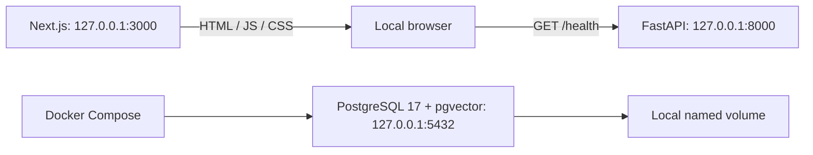

# Architecture — Milestone 1

## Current boundaries

There is no API-to-database connection in M1. The dashboard is a shell with real process-health requests and explicit planned-feature labels. It stores no accounts, documents, or conversations and displays no synthetic document data. No AI provider is installed or called.

## Frontend

`app/` holds the App Router page, metadata, and styling. Tailwind v4 is loaded through PostCSS; semantic CSS classes define the shell. System fonts avoid external font requests. `components/api-status.tsx` provides a five-second timeout, unmount cleanup, loading/error states, and manual retry. `lib/api.ts` validates health responses before reporting the API reachable.

The public API URL is frontend configuration, never a secret. Environment files are ignored; no tracking scripts are included. Internal links use Next.js navigation.

## Backend

`app/main.py` constructs the app and CORS policy, `api/` holds thin routes, `schemas/` defines response contracts, and `core/` validates configuration. `APP_MODE` accepts only `local-demo`. FastAPI generates `/docs`, `/redoc`, and `/openapi.json`. `/health` reports process liveness without checking dependencies.

Database/repository, service, model and Alembic layers will be introduced in M2 when needed. SQLAlchemy, Alembic, and PDF libraries are not installed yet; M1 adds no speculative tables or persistence abstractions.

## Infrastructure

Compose runs only the database using the pgvector PostgreSQL 17 image. A named volume persists data, the initializer enables `vector` on first startup, and `pg_isready` checks database readiness. The app services run outside Docker. The image is versioned by PostgreSQL major; choose a reviewed digest before deployment.

The database and documented app commands bind to loopback. Example credentials are local-only. No embedding model/dimension has been chosen; M3 must select and validate dimensions against its database schema.

## Security and future work

- Local-demo labels appear in the dashboard, health response, API docs, and README.
- CORS allows explicit local origins without credentials. It does not provide authorization.
- Authentication, ownership filtering, quotas, rate limits and a launch review must precede public access in M5.
- Future PDF text is untrusted. M2/M3 must validate uploads, preserve pages, scope queries to authorized documents, send only retrieved excerpts, and map citations to actual sources.
- Application code does not log provider credentials, prompts, or document text. No real user data belongs in M1.

See [ROADMAP.md](../ROADMAP.md) for authoritative scope. No document, chat, embedding, or authentication endpoints exist in M1.
