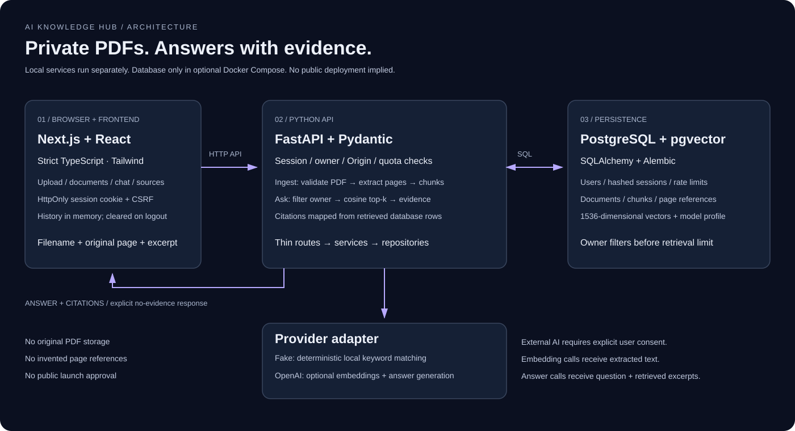
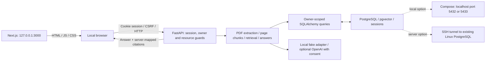

# Architecture — Milestone 6

## Current boundaries

The API connects to configured PostgreSQL. The document panel shows real metadata, extraction/indexing statuses, errors and confirmed deletion. M3 adds embeddings and a grounded Chat API; M5 adds private authenticated workspaces. Stored conversations remain unimplemented. The selected development setup is native PostgreSQL 18 on 127.0.0.1:5432 with dedicated database `ai_knowledge_hub` and database role `ai_knowledge_hub_app`. The Linux server has not been connected. Compose remains an optional development/test setup.

## Frontend

`app/` holds the App Router page, metadata, and styling. Tailwind v4 is loaded through PostCSS; semantic CSS classes define the shell. System fonts avoid external font requests. `components/api-status.tsx` provides a five-second timeout, unmount cleanup, loading/error states, and manual retry. `lib/api.ts` validates health responses before reporting the API reachable.

The public API URL is frontend configuration, never a secret. Environment files are ignored; no tracking scripts are included. Internal links use Next.js navigation.

`DocumentsPanel` now forms the M4 library view with filename/status filters, extraction/indexing details and confirmed deletion. `UploadZone` handles dropped/picked PDFs, while shared state obtains the limit/provider from the API and refreshes processing documents. Server-side validation remains authoritative. The chat and source views are described in the M4 section below. Streaming and original-PDF preview remain unimplemented.

## Backend

`app/main.py` constructs the app and CORS policy, `api/` holds thin routes, `schemas/` defines response contracts, and `core/` validates configuration. `APP_MODE` accepts `local-demo` and `authenticated`. FastAPI generates `/docs`, `/redoc`, and `/openapi.json` in development only. `/health` reports process liveness without checking dependencies.

Routes use typed schemas and dependencies, delegate ingestion to `services/`, and access data through `repositories/`. SQLAlchemy models live in `models/`, sessions in `db/`, and Alembic manages explicit schema upgrades. Database exceptions become a generic 503 without logging SQL parameters or document content. No schema is created automatically on app startup.

### Ingestion and data model

1. ASGI middleware bounds actual multipart bytes before parsing (file limit plus 64 KiB form allowance). The file itself is checked independently; the default is 10 MiB.
2. The service checks extension, declared MIME type and PDF signature. The filename is stripped of client paths/control characters and capped at 255 characters; it is never used as a filesystem path.
3. A workspace-scoped document row is committed with `processing` status so another request can observe it.
4. pypdf parses the content, rejects encryption, extracts each page, normalizes Unicode/whitespace, and skips textless pages. The original 1-based page numbering is retained. 1,000-character windows overlap by 150 characters and never cross pages.
5. All chunks and final `ready` status are committed together. Empty/scanned, damaged, encrypted or over-limit PDFs become `failed` documents with a safe explanation and no chunks. File validation errors create no document.

`documents` contains UUID, workspace UUID, filename, MIME, byte size, status/error, page/empty-page/chunk counts and timestamp. `chunks` contains UUID, document FK, globally increasing per-document chunk index, 1-based page number, text and timestamp. Constraints enforce valid status, positive size/page and unique document/chunk index. The FK has `ON DELETE CASCADE`.

Metadata, text and (in M3) embeddings are stored. Original PDF bytes are discarded after the request and cannot be downloaded. Processing is synchronous with no durable queue. An interrupted request can leave a processing row; delete and re-upload it. Deleting a currently processing document cancels its persistence through database constraints/transaction rollback rather than creating orphan chunks. Parser page/text limits reduce accidental load but do not sandbox adversarial compressed PDF resource usage.

### Demo workspace

In explicit local-demo mode, one fixed UUID comes from server settings and only unassigned documents are visible. In authenticated mode, the session determines both workspace and owner. All repository reads/deletes and retrieval filter by both; new documents receive them server-side. There is no client workspace/owner selector. `ready` means text extracted; it does not imply embeddings exist.

## Infrastructure

Compose is an optional local database/test setup using the pgvector PostgreSQL 17 image. A named volume persists data, the initializer enables `vector` on first startup, and `pg_isready` checks readiness. An existing Linux PostgreSQL server can instead be reached through a loopback SSH tunnel and `DATABASE_URL`; see [server setup](server-database.md). M3 requires pgvector on the selected server before migration. App services run outside Docker. The image is versioned by PostgreSQL major; choose a reviewed digest before deployment.

The database and documented app commands bind to loopback. Example credentials are local-only. M3 fixes vectors at 1536 dimensions and validates provider output against the schema. Fake and OpenAI profiles are never mixed.

## Security and future work

- Local-demo labels appear in the dashboard, health response, API docs, and README.
- CORS allows exact configured origins, with credentials only in authenticated mode. It does not replace authorization.
- M5 authentication, ownership filtering, quotas and rate limits are implemented; [public-launch operator prerequisites](security.md) remain.
- PDF text is untrusted and is not executed or treated as instructions. M3 must send only retrieved excerpts and map citations to actual sources; no model calls occur in M2.
- Application code does not log provider credentials, prompts, or document text. Use non-sensitive PDFs during local-demo development.

## M3 RAG pipeline

M3 extends the M2 backend boundaries with `providers/`, `repositories/retrieval.py`, `services/embeddings.py`, `services/chat.py`, and `POST /api/chat`. M4 supplies its frontend interface below. M5 adds authentication around those boundaries.

Chunks gain nullable `vector(1536)` embeddings and a provider/model profile. Documents gain separate pending/ready/failed embedding status and a safe embedding error. Existing text can be reindexed with `python -m app.reindex`. Uploads extract/commit text first, then index in batches of 32. All returned vectors are checked for dimension, count, finite representable values and nonzero norm before publishing a document's new vectors.

The default fake provider hashes keyword features deterministically and returns matching excerpts with an explicit fake label. It is not semantic AI. OpenAI requires both explicit `AI_PROVIDER=openai` and a key. The adapter embeds chunk text and sends only top retrieved excerpts to structured answer generation, with untrusted-data instructions, no tools and response storage disabled. No live OpenAI call has been verified.

Retrieval filters workspace, optional document IDs, text/embedding readiness and embedding profile before threshold/order/top-k. PostgreSQL computes exact cosine distance; SQLite is only the test fallback. Provider output contains source IDs, not citation metadata. The server rejects unknown IDs and attaches filename/page/excerpt from actual retrieved rows. Lack of candidates or provider abstention yields an explicit no-evidence response and empty citations. This validates source identity, not every semantic assertion from a real LLM.

The initial PostgreSQL test isolation failed through public version-table fallback and lost one existing project document. See [the incident report and fix](verification-m3.md). Alembic version tables are now schema-qualified; test ORM tables are explicitly translated and resolution is checked before use. The project schema was recreated; the document requires re-upload.

## M4 frontend workspace

The shared root layout wraps both `/` (chat) and `/documents` in `WorkspaceShell` and `WorkspaceProvider`. Server page components stay thin; client components own interactivity. The provider centralizes document fetching, upload/delete operations, search-scope selection and ephemeral chat turns, so internal route navigation preserves the current tab's state. API credentials are never included in this client state.

`UploadZone` validates one dropped/picked PDF before sending it to the existing authoritative backend validation. `DocumentsPanel` supplies filename/status filtering and confirmed deletion. `ChatWorkspace` submits an explicit snapshot of selected indexed document IDs to `/api/chat`; `SourcesPanel` renders citations from the selected completed response. `lib/chat.ts` validates response structure, positive page numbers, consistent evidence flags and citation IDs belonging to the submitted scope before displaying an answer.

UI retries are explicit, never automatic. Cancellation invalidates the pending request and ignores late responses. A 45-second timeout prevents indefinite answer loading. Answer text/excerpts are plain React text. The browser stores at most 20 turns in memory; it does not persist prompts or source excerpts to local storage. Deletion removes related current-tab turns only after the API confirms success. No server-side chat persistence or cross-tab synchronization is implied.

The shell, library and chat/source layout are responsive. Browser automation uses isolated contexts with API fixtures and a separate local production server. A separate generated-PDF live smoke test verifies the real backend wiring without touching pre-existing document IDs. No database migration is part of M4.

## M5 private accounts

`AuthProvider` checks `/api/auth/session` before mounting the private workspace. Login/registration use the API; the browser receives only user metadata and a CSRF token, while the session token stays in an HttpOnly cookie. API clients send credentials and unsafe-method CSRF headers. A 401 unmounts private state. `WorkspaceProvider` is keyed by account ID so documents, selection, sources and history cannot survive an account switch. BroadcastChannel clears other tabs on session changes. `/privacy` is public; `/account` supplies consent, usage, password change and deletion controls. Both routes are client-gated for UX; the API independently authorizes every private operation.

`PrincipalDependency` validates the hashed database session, expiry, Origin/CSRF and protected-user limits. Thin auth/account routes use `AuthService` for hashing, login, rotation and revocation. The database holds `users`, `auth_sessions` and `rate_buckets`; `documents.owner_id` cascades on user deletion. `chunks` continue to cascade on document deletion. No PDF file/object-storage cleanup is necessary because originals are never retained. Null-owner demo documents stay inaccessible to authenticated users until an explicit operator transfer.

Limits use atomic PostgreSQL counters and per-user locks for quota serialization. Sessions, rate limits and storage ownership are shared across API workers without another service. Registration is a development option and must be closed in production. Quotas and consent are enforced on the API even when bypassing the UI. Authenticated OpenAI reindex requires an explicit account and its stored consent.

## M6 reproducible portfolio boundary

`examples/` holds a small original CC0 handbook plus text/question manifest. `app.seed_demo` uses the ordinary scoped repository and document service for an explicitly selected account, never startup code. It rejects production/external-provider modes and incompatible existing sample names. Its preview is read-only and repeated sequential import returns the matching document ID. The sample's licensing scope is separate from application code.

The portfolio capture harness creates a disposable PostgreSQL/pgvector cluster, verifies its data directory, applies real migrations there and runs a temporary authenticated/fake FastAPI service. A separate production Next.js process is exercised through Playwright with real registrations, upload, retrieval, three page-mapped answers, no-evidence behavior and a second account's isolation checks. Browser annotations identify real regions; they do not replace answer/document content. All accounts/data in published screenshot assets are synthetic. The personal development database and `.env` remain separate. Fixture-based UI tests continue independently.

See [the demo guide](demo.md), [M6 verification](verification-m6.md), and [security/deployment review](security.md) for reproduction and remaining launch gates. No deployment occurs in M6. See [ROADMAP.md](../ROADMAP.md) for authoritative scope.
