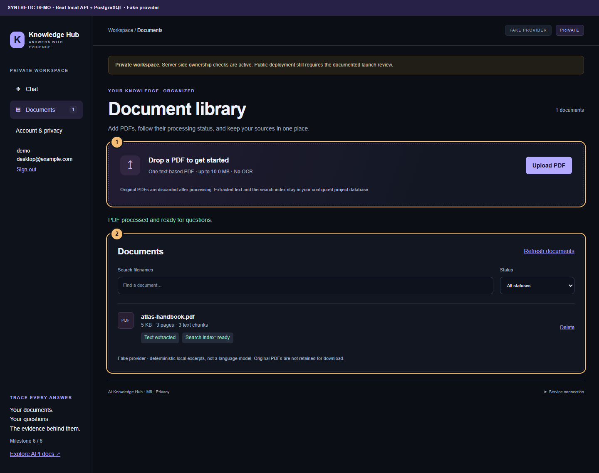
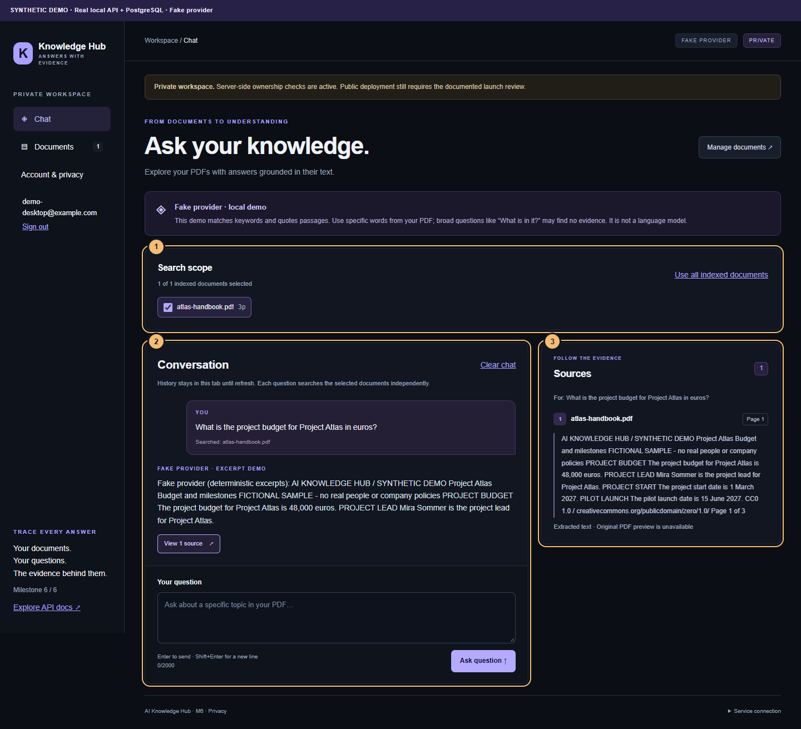
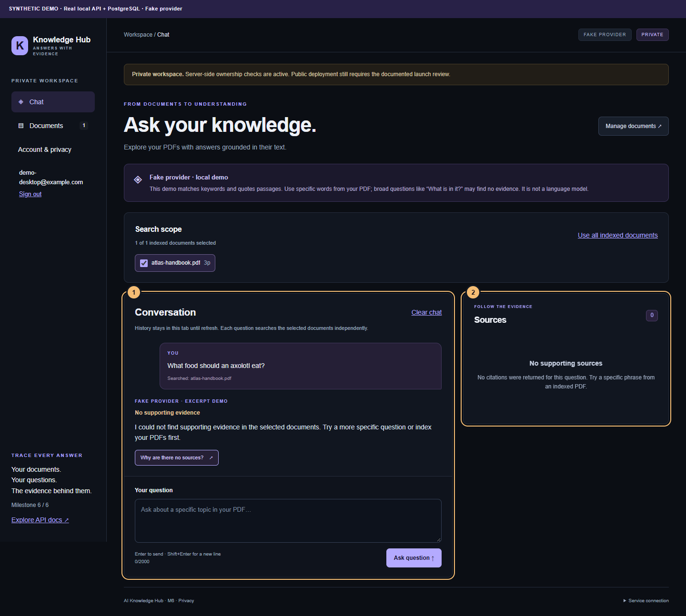
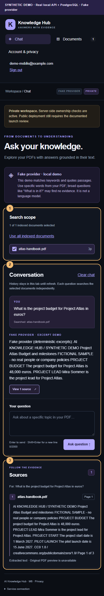

# Two-minute portfolio walkthrough

Use the bundled [CC0 sample](../examples/README.md). All captured example accounts and document facts are synthetic. The screenshots below were made with the real UI, FastAPI, PostgreSQL/pgvector and the local fake provider. They are not evidence of live OpenAI answer quality.

## Prepare

Start the local stack using README, register a dedicated development demo account, and use `AI_PROVIDER=fake`. Upload `examples/atlas-handbook.pdf` or import it with the documented `app.seed_demo --email ... --confirm` command. For a live presentation of upload, leave the sample unimported until that scene. Have a second synthetic account ready in a separate browser profile; do not expose a personal email or documents in a recording. Turn off password-manager popups and notifications. Pre-open the architecture diagram in another tab.

## Recording script (120 seconds)

| Time | Action | Suggested narration |
| --- | --- | --- |
| 0:00–0:15 | Sign in to the dedicated synthetic account. | “AI Knowledge Hub turns private PDFs into answers with evidence. This is a portfolio demo using fictional data and a deterministic local provider.” |
| 0:15–0:35 | Open Documents and upload `atlas-handbook.pdf`; wait for index-ready. | “The FastAPI backend validates the PDF, extracts text page by page and stores chunks and embeddings in PostgreSQL with pgvector. The original file is discarded.” |
| 0:35–1:00 | Open Chat, select only the sample and ask the budget question exactly as listed. | “The server searches only documents owned by this account. The fake provider returns matching source sentences so the retrieval path can be tested without API credentials.” |
| 1:00–1:20 | Click View source; point to filename, Page 1 and the 48,000-euro passage. | “The server maps citations to actual retrieved chunks and original page numbers. The browser shows the stored passage next to the answer.” |
| 1:20–1:35 | Ask “What food should an axolotl eat?” | “This topic is absent from the selected document, so the result explicitly reports no supporting evidence and supplies no citation.” |
| 1:35–1:50 | Switch to the second browser profile/account with its empty library. | “Isolation is enforced in database queries, not by hiding controls. This account cannot list or retrieve the other account's PDF.” |
| 1:50–2:00 | Show the architecture diagram. | “The stack is Next.js and TypeScript, Python and FastAPI, and PostgreSQL/pgvector. Automated tests cover ownership and source mapping. Public launch still needs the documented operational review.” |

Prepare the second account before recording to keep within two minutes. A transcript is not a claim that a video has been recorded. Do not present the fake provider as semantic search or an LLM. Optional OpenAI generation exists behind the same adapter, but real network behavior and answer quality are outside these screenshots.

## Annotated screenshots

The numbered outlines and synthetic-demo strip are documentation overlays added in the browser after checks; product content is not edited or fabricated. Desktop is 1440×1100; mobile is 390×844. Each capture uses a newly registered synthetic account in a disposable native PostgreSQL cluster. Example uploads, citations and the no-evidence case use real API responses.

### Document ingestion



1. PDF upload uses server validation and the configured size limit.
2. The library displays actual metadata, three original pages, chunk count and a ready search index.

### Grounded answer and source



1. Explicit document selection restricts the search scope.
2. The response is visibly marked as fake-provider output.
3. The source card maps to the uploaded filename, Page 1 and its extracted passage.

### Unsupported question



1. An unrelated question produces a no-evidence response.
2. No supporting citation is invented.

### Mobile



The same numbered chat regions stack vertically; horizontal overflow is checked. [Mobile library](assets/documents-mobile.png) and [mobile no-evidence state](assets/no-evidence-mobile.png) are also captured.

## Reproduce the captures safely

Windows, from `frontend/`, install dependencies and build:

```powershell
npm.cmd ci
npm.cmd run build
```

Then, from `backend/`, with Node/npm on PATH and PostgreSQL plus its matching pgvector extension installed:

```powershell
.\.venv\Scripts\python.exe scripts/test_postgres.py --pg-bin 'D:\Program Files\PostgreSQL\18\bin' --portfolio
```

Adjust the PostgreSQL binary directory to your installation. The helper creates a separate cluster on loopback port 55432 with a random credential, checks its data-directory identity, migrates only that cluster, starts a private temporary API on 8810 and a local production frontend on 3200, and records the real flows. Those ports must be free. It forces development/authenticated/fake mode with fresh synthetic users and a temporary security key, regardless of the private project `.env` database/provider settings. Only screenshot PNGs are kept under `docs/assets/`; backend, frontend and temporary cluster are stopped afterward. No existing account/document or `.env` setting is changed.

Playwright forwards browser API request transport to the disposable API without fulfilling or mocking any response. The production build's public API hostname is therefore irrelevant to this recording; it must still be a well-formed HTTP URL. The test also verifies a second account has an empty listing and receives 404 for the first account's document. This capture command is distinct from `npm run test:e2e`, which continues to use isolated simulated APIs.

On Linux/macOS, the regular app/sample/seed workflows use `.venv/bin/python`. The all-in-one capture helper targets Windows; port its PostgreSQL process management to your platform or use a disposable database and equivalent staging setup. Do not point screenshot automation at a persistent personal database. No public deployment, analytics or video publication is part of M6.
